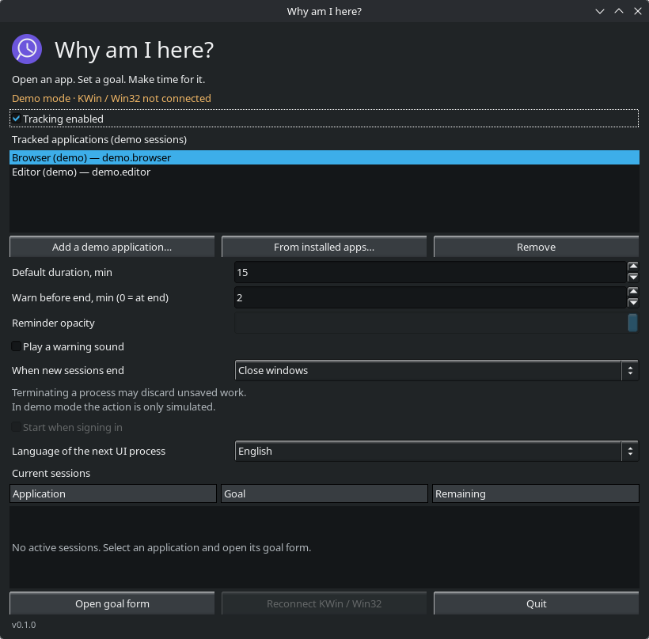
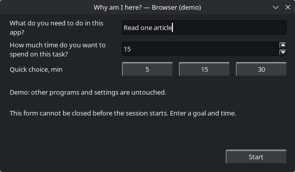
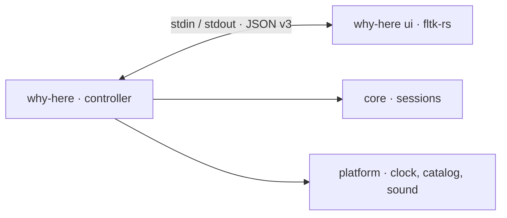

<p align="center">
  
</p>

<h1 align="center">Why am I here?</h1>

<p align="center"><strong>Open an app. Set a goal. Make time for it.</strong></p>

<p align="center">
  <a href="README.ru.md">Русский</a> · <strong>English</strong>
</p>

<p align="center">
  
  
  <a href="https://github.com/fltk-rs/fltk-rs"></a>
  <a href="LICENSE"></a>
</p>

<p align="center">
  <a href="#quick-start">Quick start</a> ·
  <a href="#screenshots">Screenshots</a> ·
  <a href="#features">Features</a> ·
  <a href="#build">Build</a> ·
  <a href="#roadmap">Roadmap</a>
</p>

A small desktop utility for intentional app use. Decide what you came to do,
choose a time budget, and keep your goal beside a compact countdown.
Built in Rust with fltk-rs, targeting **KDE Plasma 6 / Wayland** and **Windows 10/11**.
The application works locally, with no account, server or network requests.

> [!IMPORTANT]
> **Currently a working demo.** Goal entry, timers, installed-app selection and
> warning sounds work. Closing windows and terminating applications are simulated.
> Demo settings stay in memory; other applications are left untouched.

## Quick start

Install the [build prerequisites](#build), then open the dashboard:

```bash
cargo run --release -p app -- --demo --show --language en
```

1. Select a demo application, or choose **From installed apps…**.
2. Set a duration and warning interval, then choose **Open goal form**.
3. Write your goal and press **Start**. Drag the compact session panel wherever
   it is useful; **End session now** simulates finishing early.

**15 minutes** by default · **5 / 15 / 30** minute presets · Russian and English UI

## Screenshots

<p align="center">
  
  <br><sub>Settings dashboard · KDE Plasma 6 · sample data</sub>
</p>

<p align="center">
  
  <br><sub>One goal, one time budget, one Start button</sub>
</p>

## Features

| | What you can do today |
| :--- | :--- |
| 🎯 **Set an intention** | Enter a goal before the timer starts. Start stays disabled until the goal is valid. |
| ⏱ **Choose your time** | Use 5 / 15 / 30 minute presets or set 1–1440 minutes. |
| 🗂 **Pick an application** | Search installed apps by name or ID; add and remove apps in the demo list. Nothing is launched. |
| 🪟 **Keep the goal nearby** | A small, draggable, borderless panel shows the app, goal, remaining time and end mode. |
| 🔔 **Get a warning** | The countdown turns amber near the deadline. Enable one warning sound per session if you want it. |
| 🌐 **Use either language** | Russian and English; the dashboard's language choice applies to the next UI process. |
| 🔒 **Keep it local** | No accounts, telemetry or app network requests. Demo settings and goal history disappear on exit. |

<details>
<summary><strong>How the demo behaves</strong></summary>

- No countdown runs until you submit a goal.
- In **Close windows** mode, the goal form cannot be dismissed. In **Terminate
  processes** mode, closing it or pressing Escape simulates ending the application.
- The session's end mode is fixed when it is created. **End session now** shows
  the simulated result; Escape on the timer panel cancels without that action.
- **Try again** opens another goal form with the previous goal.
- A warning interval of **0** disables advance warning. Sound is off by default;
  when enabled, the embedded WAV plays once at the warning or at expiry if no
  warning has played yet. Sound errors do not stop the timer.
- The installed-app catalog loads only on request, in a worker. Linux reads XDG
  desktop entries; Windows reads the current user's Start menu. Selection never
  executes a desktop entry or launches an app.
- KWin/Win32 reconnection, opacity and autostart controls are visibly disabled
  until their integrations exist. The dashboard's session area is initially empty:
  this demo starts one simulated session after you leave the dashboard.

</details>

## Build

**Required:** stable Rust, a C++ compiler, **CMake 3.28+**, and Make or Ninja.
Cargo downloads dependencies during the build; the application itself stays local.

<details>
<summary><strong>Linux · KDE Plasma 6 / Wayland</strong></summary>

On Debian/Ubuntu:

```bash
sudo apt install build-essential cmake pkg-config libwayland-dev wayland-protocols \
  libxkbcommon-dev libdbus-1-dev libpango1.0-dev libcairo2-dev \
  libx11-dev libxext-dev libxft-dev libxinerama-dev libxcursor-dev \
  libxrender-dev libxfixes-dev
```

For sound, also install the PipeWire tools providing `pw-play` (`pipewire-bin`
on Debian/Ubuntu).

The build checks the Wayland development dependencies. After installing packages
missing from a previous build, run `cargo clean -p fltk-sys` once so that an older
X11-only FLTK build is discarded. Verify that your CMake meets the minimum version.

```bash
cargo build --release -p app
./target/release/why-here --demo --show --language en
```

</details>

<details>
<summary><strong>Windows 10 / 11</strong></summary>

Install stable Rust with the **MSVC** toolchain, Visual Studio Build Tools with
**Desktop development with C++**, and CMake available in `PATH`.

```powershell
cargo build --release -p app
.\target\release\why-here.exe --demo --show --language en
```

Windows uses the built-in Start menu query and `PlaySoundW`; no separate audio
player is required. Windows-specific code is cross-checked from Linux, but the
Windows application still needs runtime verification.

</details>

<details>
<summary><strong>More commands</strong></summary>

| Command | Opens |
| :--- | :--- |
| `cargo run -p app -- --demo` | Goal → timer → simulated result, in Russian |
| `cargo run -p app -- --demo --language en` | The same flow in English |
| `cargo run -p app -- --demo --show` | Demo settings dashboard |
| `cargo run -p app -- ui goal --demo` | A standalone goal-form preview |
| `cargo run -p app -- ui timer --demo` | A standalone timer preview |

Use `reminder` or `settings` instead of `goal` to preview those screens.
The timer preview exits on expiry or **End session now**. `--help` lists commands;
`--version` prints the workspace version. Without `--demo`, `ui` is an internal
mode requiring initialization over stdin.

Normal startup, `--show` and `--background` **without `--demo`** are not implemented.
Running the demo does not install the app or add it to autostart.

</details>

## Roadmap

- [ ] Persist settings and goal history, with backward-compatible loading.
- [ ] Add the tray and single-instance routing.
- [ ] Connect real window tracking and blocking through KWin and Win32.
- [ ] Implement window closing and protected process-tree termination.
- [ ] Meet the memory budgets and validate both platforms on real desktops.
- [ ] Add autostart, packaging and releases.

### Platform status

| Platform | Verified | Still to verify |
| :--- | :--- | :--- |
| **KDE Plasma 6 / Wayland** | Native UI and picker, app ID, IPC, catalog selection; PipeWire playback at zero stream volume | Real window control, suspend/resume, full desktop integration |
| **Windows 10 / 11** | Cross-compilation of `core`, `platform` and `daemon`; Windows CI configured | GUI, Start menu catalog, audible playback and real window control |

The **8 MiB daemon / 15 MiB UI** memory targets are not yet met. An earlier native
Wayland release measurement showed approximately **8.9 / 26.5 MiB** respectively;
RSS has not been remeasured after the latest UI work. See [TESTING.md](TESTING.md)
for measurements, validation limits and manual checks.

## Development

```bash
cargo fmt --all --check
cargo clippy --workspace --all-targets -- -D warnings
cargo test --workspace
git diff --check
```

The [CI workflow](.github/workflows/check.yml) checks Linux and Windows builds.
Headless tests do not prove real window control; the separate GUI test is
`#[ignore]` and requires a running desktop. See [TESTING.md](TESTING.md).

<details>
<summary><strong>Under the hood</strong></summary>

One executable, separate controller and UI processes. Windows exist only when
needed; the controller blocks on events and ticks once per second while a timer
is active. The UI never manages other applications' windows or processes.



| Crate | Responsibility |
| :--- | :--- |
| [`core`](crates/core) | Session engine, settings model, goal history, translations and versioned IPC |
| [`platform`](crates/platform) | Sleep-aware boot clocks, installed apps and sound; native `unsafe` stays here |
| [`daemon`](crates/daemon) | Demo orchestration, UI lifetime and worker tasks; no FLTK dependency |
| [`ui`](crates/ui) | Dark fltk-rs screens and app picker; Linux enables `use-wayland` |
| [`app`](crates/app) | CLI and mode selection for `why-here` |

The engine supports independent application sessions, preserves exact app IDs
and fixes each session's end mode. Clocks use `CLOCK_BOOTTIME` on Linux and
`QueryInterruptTime` on Windows. IPC version 3 rejects unsupported versions and
messages over 64 KiB; catalogs are streamed in small chunks.

</details>

---

<p align="center">Made with Rust and fltk-rs · <a href="LICENSE">MIT License</a></p>
