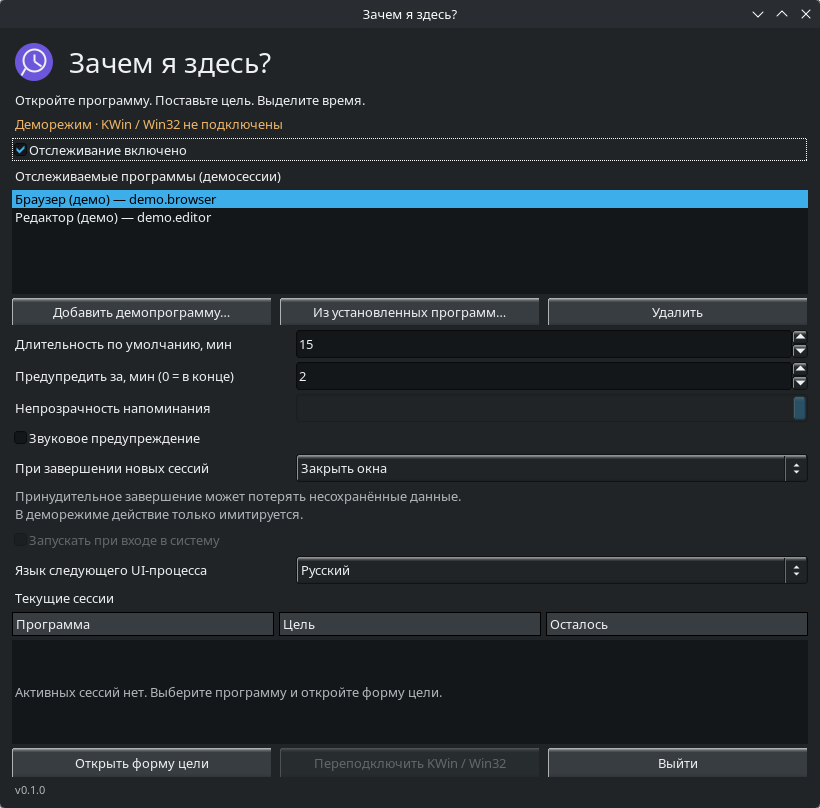
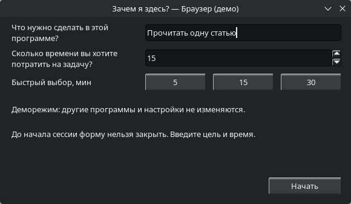
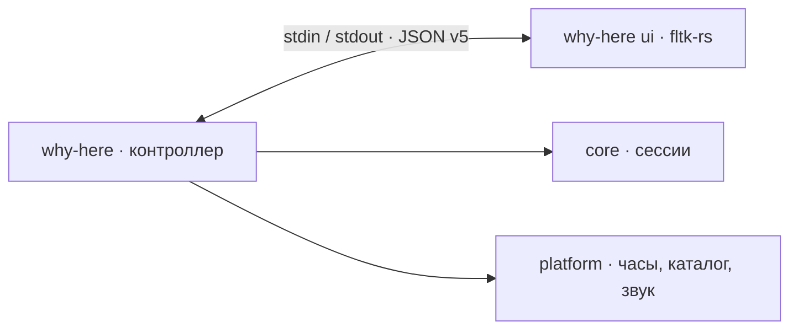

<p align="center">
  
</p>

<h1 align="center">Зачем я здесь?</h1>

<p align="center"><strong>Откройте программу. Поставьте цель. Выделите время.</strong></p>

<p align="center">
  <strong>Русский</strong> · <a href="README.md">English</a>
</p>

<p align="center">
  
  
  <a href="https://github.com/fltk-rs/fltk-rs"></a>
  <a href="LICENSE"></a>
</p>

<p align="center">
  <a href="#быстрый-старт">Быстрый старт</a> ·
  <a href="#скриншоты">Скриншоты</a> ·
  <a href="#возможности">Возможности</a> ·
  <a href="#сборка">Сборка</a> ·
  <a href="#планы">Планы</a>
</p>

Небольшая настольная утилита для осознанного использования программ. Решите,
зачем открыли приложение, выделите время и держите цель рядом с таймером.
Написана на Rust с fltk-rs для **KDE Plasma 6 / Wayland** и **Windows 10/11**.
Приложение работает локально: без аккаунта, сервера и сетевых запросов.

> [!IMPORTANT]
> **Работают трей, постоянные настройки и деморежим.** Форма цели, таймер, выбор установленных
> программ и звуковое предупреждение работают. Закрытие окон и завершение
> программ имитируются. Настройки деморежима хранятся в памяти; другие приложения не затрагиваются.
> Обычный запуск открывает настройки и остаётся в трее; отслеживание окон пока не подключено.

## Быстрый старт

Готовые архивы Linux x86_64 и Windows x86_64 — в [Releases](https://github.com/hlophlopgaming/why-i-m-here-RS/releases).
Распакуйте архив и запустите `why-here --demo --show` (Windows: `why-here.exe --demo --show`).
Сборка Linux требует glibc 2.35+ и библиотек Wayland/X11, Pango/Cairo, fontconfig
и libdecor; это переносимый архив, не установщик. В Windows отдельные библиотеки FLTK не нужны; при ошибке отсутствия
`VCRUNTIME140*.dll` установите [Visual C++ Redistributable x64](https://learn.microsoft.com/cpp/windows/latest-supported-vc-redist).
Контрольные суммы архивов находятся в `SHA256SUMS` рядом с выпуском.

Для запуска из исходников установите [зависимости для сборки](#сборка):

```bash
cargo run --release -p app -- --demo --show
```

1. Выберите демопрограмму или нажмите **«Из установленных программ…»**.
2. Задайте время и интервал предупреждения, нажмите **«Открыть форму цели»**.
3. Опишите задачу и нажмите **«Начать»**. Перетащите компактную панель сессии
   в удобное место; **«Завершить сессию сейчас»** имитирует досрочное завершение.

**15 минут** по умолчанию · Пресеты **5 / 15 / 30** минут · Русский и английский UI

## Скриншоты

<p align="center">
  
  <br><sub>Панель настроек · KDE Plasma 6 · демонстрационные данные</sub>
</p>

<p align="center">
  
  <br><sub>Одна цель, заданное время и кнопка «Начать»</sub>
</p>

## Возможности

| | Что уже работает |
| :--- | :--- |
| 🎯 **Осознанная цель** | До ответа таймер не запущен. «Начать» становится доступна после ввода корректной цели. |
| ⏱ **Выбор времени** | Пресеты 5 / 15 / 30 минут или своя длительность от 1 до 1440 минут. |
| 🗂 **Выбор программы** | Поиск установленных приложений по имени и ID, добавление и удаление в демосписке. Программы не запускаются. |
| 🪟 **Цель перед глазами** | Маленькая перетаскиваемая панель без рамки: программа, задача, оставшееся время и способ завершения. |
| 🔔 **Предупреждение** | Перед концом отсчёт становится янтарным. По желанию — один звуковой сигнал за сессию. |
| 🌐 **Два языка** | Русский и английский. Выбор в настройках применяется к следующему UI-процессу. |
| 🔒 **Локальная работа** | Без аккаунтов, телеметрии и сетевых запросов приложения. Настройки и история деморежима исчезают при выходе. |

<details>
<summary><strong>Как ведёт себя демонстрация</strong></summary>

- До отправки цели отсчёт не начинается.
- В режиме **«Закрыть окна»** форму цели нельзя закрыть. В режиме **«Завершить
  процессы»** её закрытие или Escape имитирует завершение программы.
- Способ завершения фиксируется при создании сессии. **«Завершить сессию
  сейчас»** показывает имитацию результата; Escape на панели таймера отменяет
  сессию без этого действия.
- **«Ещё раз»** открывает новую форму с предыдущей целью.
- Интервал предупреждения **0** отключает предварительный сигнал. Звук по
  умолчанию выключен; при включении встроенный WAV звучит один раз — перед
  концом или при истечении, если раньше не звучал. Ошибка звука не прерывает таймер.
- Каталог установленных программ загружается только по запросу в рабочем потоке.
  Linux читает записи XDG, Windows — AppsFolder текущего пользователя через COM,
  без запуска PowerShell.
  Выбор не исполняет desktop-файл и не запускает программу.
- Переподключение KWin/Win32, прозрачность и автозапуск явно недоступны до
  реализации интеграций. Область сессий на панели настроек сначала пуста:
  единственная демосессия начинается после выхода из этой панели.

</details>

## Сборка

**Нужны:** стабильный Rust, компилятор C++, **CMake 3.28+** и Make либо Ninja.
Cargo загружает зависимости при сборке; само приложение работает локально.

<details>
<summary><strong>Linux · KDE Plasma 6 / Wayland</strong></summary>

В Debian/Ubuntu:

```bash
sudo apt install build-essential cmake pkg-config libwayland-dev wayland-protocols \
  libxkbcommon-dev libdbus-1-dev libpango1.0-dev libcairo2-dev \
  libx11-dev libxext-dev libxft-dev libxinerama-dev libxcursor-dev \
  libxrender-dev libxfixes-dev
```

В Arch Linux / EndeavourOS установите инструменты сборки и протоколы:

```bash
sudo pacman -S --needed base-devel cmake pkgconf wayland wayland-protocols libxkbcommon dbus pango cairo libx11 libxext libxft libxinerama libxcursor libxrender libxfixes
```

Для звука также нужны инструменты PipeWire с командой `pw-play`
(пакет `pipewire-bin` в Debian/Ubuntu).

Сборка проверяет зависимости Wayland. Если раньше нужных пакетов не было,
после их установки один раз выполните `cargo clean -p fltk-sys`, чтобы удалить
прежнюю сборку FLTK только с X11. Проверьте минимальную версию CMake.

```bash
cargo build --release -p app
./target/release/why-here --demo --show
```

</details>

<details>
<summary><strong>Windows 10 / 11</strong></summary>

Установите стабильный Rust с toolchain **MSVC**, Visual Studio Build Tools
с компонентом **«Разработка классических приложений на C++»** и CMake в `PATH`.

```powershell
cargo build --release -p app
.\target\release\why-here.exe --demo --show
```

Используются встроенный запрос меню «Пуск» и `PlaySoundW`; отдельный звуковой
плеер не нужен. Windows-код проходит кросс-проверку из Linux, но запуск приложения
в Windows ещё требует проверки.

</details>

<details>
<summary><strong>Другие команды</strong></summary>

| Команда | Что открывает |
| :--- | :--- |
| `cargo run -p app` | Настройки и демон в трее |
| `cargo run -p app -- --background` | Демон в трее без окна |
| `cargo run -p app -- --show` | Настройки работающего экземпляра |
| `cargo run -p app -- --demo` | Цель → таймер → имитация результата на русском |
| `cargo run -p app -- --demo --language en` | Тот же сценарий на английском |
| `cargo run -p app -- --demo --show` | Настройки демонстрации |
| `cargo run -p app -- ui goal --demo` | Отдельный просмотр формы цели |
| `cargo run -p app -- ui timer --demo` | Отдельный просмотр таймера |

Вместо `goal` можно указать `reminder` или `settings` для просмотра других экранов.
Просмотр таймера завершается по времени или по кнопке **«Завершить сессию сейчас»**.
`--help` показывает команды, `--version` — версию workspace. Без `--demo` режим
`ui` внутренний и требует инициализации через stdin.

`cargo run -p app -- --show` открывает настройки с кнопкой **«Сохранить и закрыть»**.
Сохраняются выбранные программы, язык и параметры будущих сессий. Закрытие окна
или **«Закрыть настройки»** отменяет изменения. Закрытие окна завершает только UI;
демон остаётся в трее. Для выхода выберите **«Выйти из приложения»** в меню трея. Сессии из этой панели пока не запускаются.
`--language ru|en` переопределяет сохранённый язык для этого открытия; новое
значение записывается только по кнопке сохранения.

Файл: `${XDG_CONFIG_HOME:-~/.config}/why-here/settings.json` в Linux,
`%APPDATA%\WhyHere\settings.json` в Windows. Отсутствующий файл означает настройки
по умолчанию. Повреждённый файл вызывает ошибку без перезаписи; старые файлы
получают значения по умолчанию для новых полей, неизвестные поля сохраняются.
При ошибке записи панель остаётся открытой для повторной попытки.

`--background` оставляет процесс работать в трее без окна. Повторный обычный
запуск или `--show` обращается к работающему демону и показывает одно окно
настроек; повторный `--background` ничего не открывает. `--language` применяется
при создании следующего окна, уже открытая форма сохраняет свой язык.
Единственный экземпляр определяется по D-Bus в Linux и mutex/pipe в Windows.
В Linux необходимы сессионная D-Bus-шина и StatusNotifierHost (например, Plasma).
Демонстрация ничего не устанавливает и не добавляет в автозапуск.

</details>

## Планы

- [x] Сохранение настроек с совместимостью старых данных.
- [ ] Подключение истории целей к реальным сессиям (демоистория остаётся временной).
- [x] Трей и единственный экземпляр приложения.
- [ ] Реальное отслеживание и блокировка окон через KWin и Win32.
- [ ] Закрытие окон и защищённое завершение дерева процессов.
- [ ] Проверки обеих платформ на реальных системах и контроль регрессий памяти.
- [ ] Автозапуск, упаковка и релизы.

### Готовность платформ

| Платформа | Проверено | Ещё предстоит |
| :--- | :--- | :--- |
| **KDE Plasma 6 / Wayland** | Нативные окна и выбор программы, app_id, IPC, каталог; PipeWire с нулевой громкостью потока | Управление реальными окнами, сон/пробуждение, полная интеграция |
| **Windows 10 / 11** | Кросс-компиляция `core`, `platform`, `daemon`; каталог AppsFolder в Windows CI | Запуск GUI, каталог «Пуска», слышимость звука и управление реальными окнами |

Жёсткие лимиты **8 МиБ для демона / 15 МиБ для UI** сняты: ориентир —
воспроизводимые измерения и отсутствие регрессий.
Последний проход оптимизации релизной сборки снизил RSS демона примерно на
**7–9%**, размер бинарника — на **30%**: на проверенной машине демон в фоне
занимает около **10,6 МиБ**, настройки — около **30 МиБ**. Это точечные RSS-замеры
на Linux; Windows и другие экраны требуют отдельных измерений.
Методика и сравнение вариантов — в [BENCHMARKS.md](BENCHMARKS.md), ручные
проверки — в [TESTING.md](TESTING.md).

## Разработка

```bash
cargo fmt --all --check
cargo clippy --workspace --all-targets -- -D warnings
cargo test --workspace
git diff --check
```

[CI](.github/workflows/check.yml) проверяет сборки Linux и Windows.
Headless-тесты не подтверждают управление реальными окнами; отдельный GUI-тест
помечен `#[ignore]` и требует запущенного рабочего стола. См. [TESTING.md](TESTING.md).

<details>
<summary><strong>Как устроено приложение</strong></summary>

Один исполняемый файл, отдельные процессы контроллера и UI. Окна создаются
по требованию; контроллер ждёт событий и тикает раз в секунду только при активном
таймере. UI не управляет окнами и процессами других приложений.



| Крейт | Ответственность |
| :--- | :--- |
| [`core`](crates/core) | Движок сессий, модель настроек, история целей, переводы и версионированный IPC |
| [`platform`](crates/platform) | Часы с учётом сна, установленные программы и звук; нативный `unsafe` только здесь |
| [`daemon`](crates/daemon) | Трей, фоновый цикл событий, единственный экземпляр, демонстрация и UI-процессы; без зависимости от FLTK |
| [`ui`](crates/ui) | Тёмные экраны и выбор программы на fltk-rs; в Linux включена фича `use-wayland` |
| [`app`](crates/app) | Аргументы CLI и выбор режима `why-here` |

Движок поддерживает независимые сессии программ, сохраняет точные ID и фиксирует
способ завершения каждой сессии. Часы используют `CLOCK_BOOTTIME` в Linux
и `QueryInterruptTime` в Windows. IPC версии 5 отклоняет неподдерживаемые версии
и сообщения больше 64 КиБ; каталог передаётся небольшими порциями.

</details>

---

<p align="center">Сделано на Rust и fltk-rs · <a href="LICENSE">Лицензия MIT</a></p>
